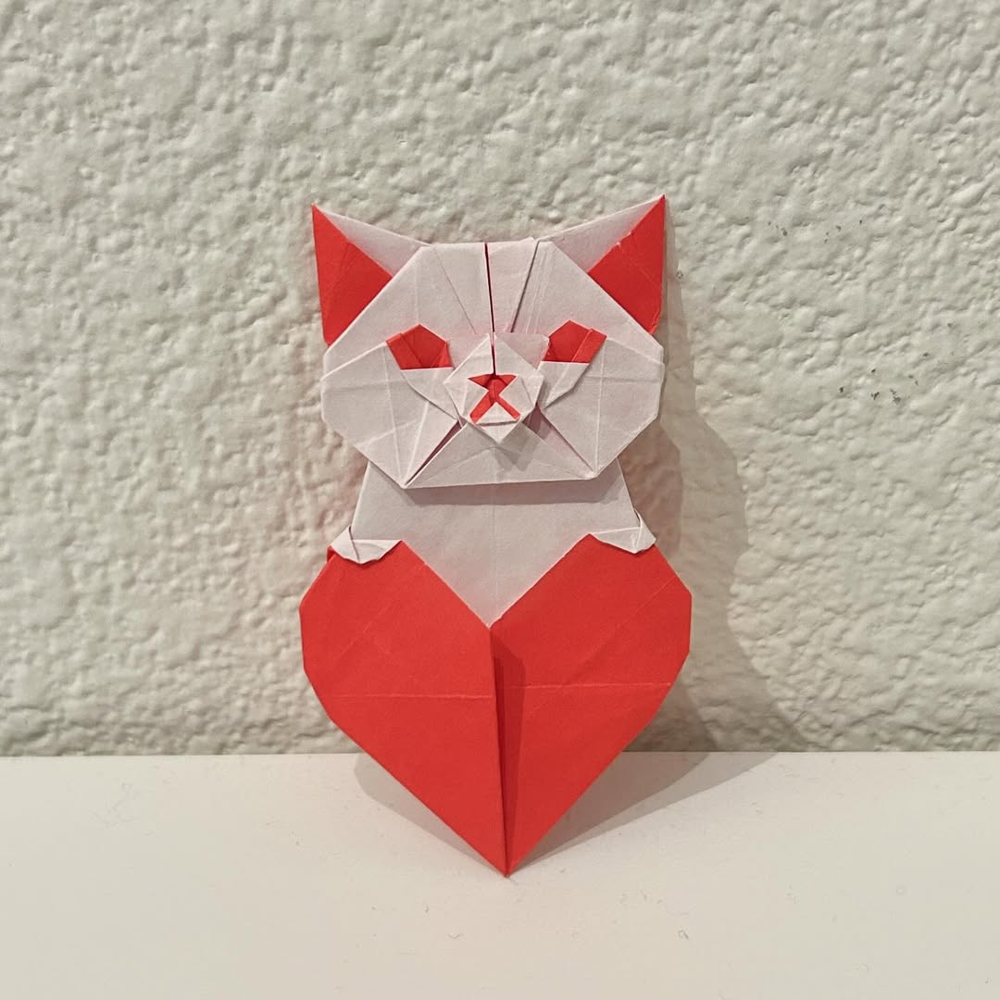
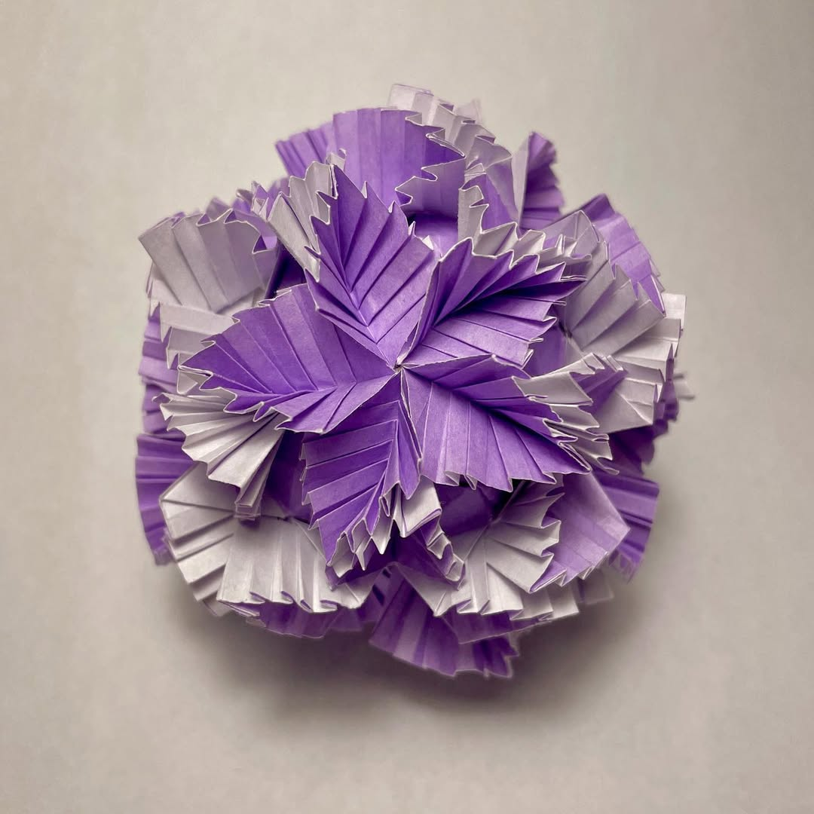
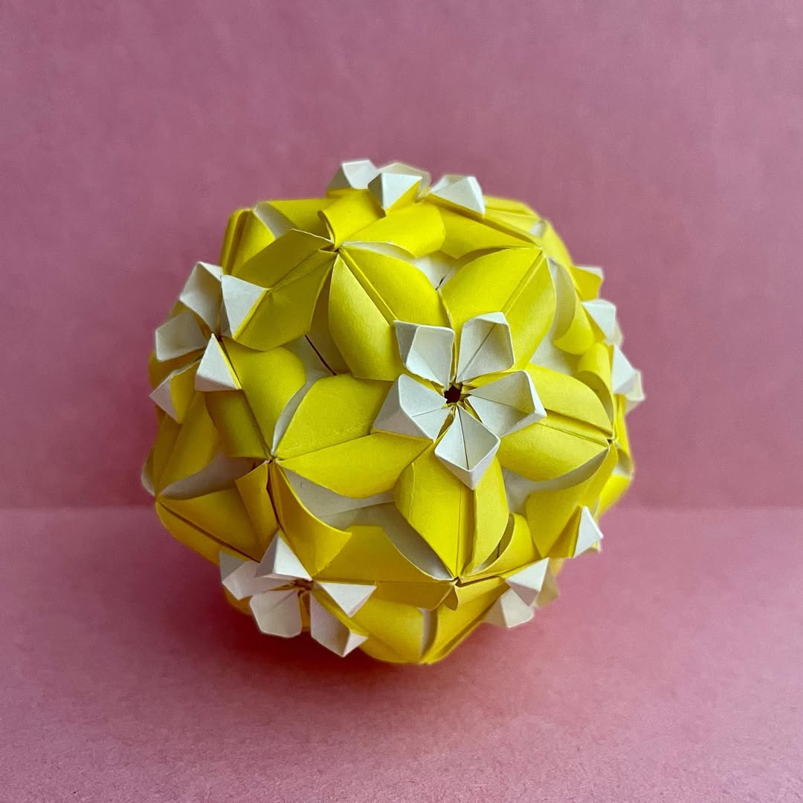
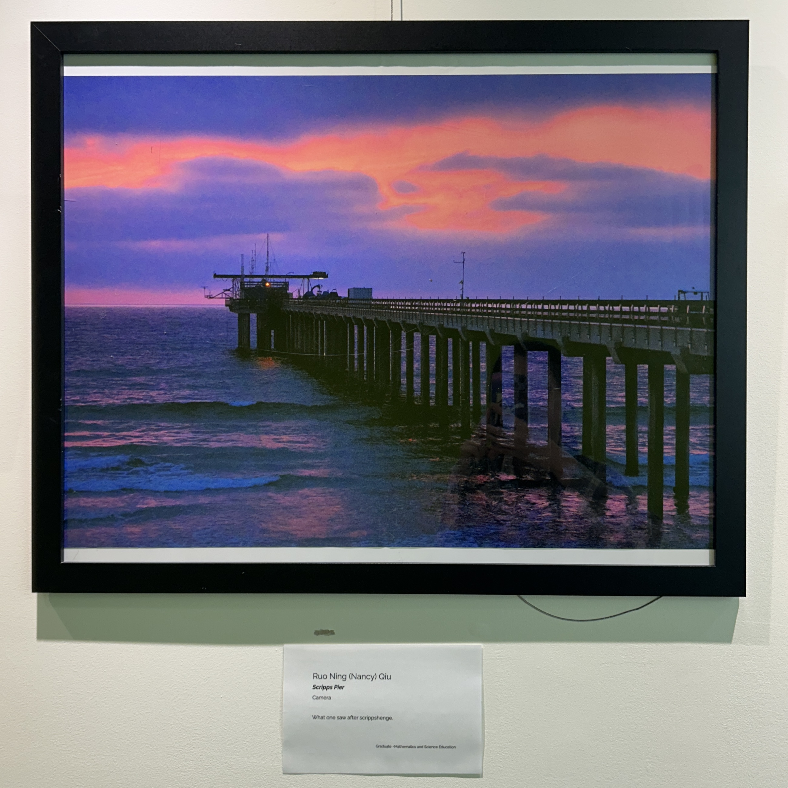
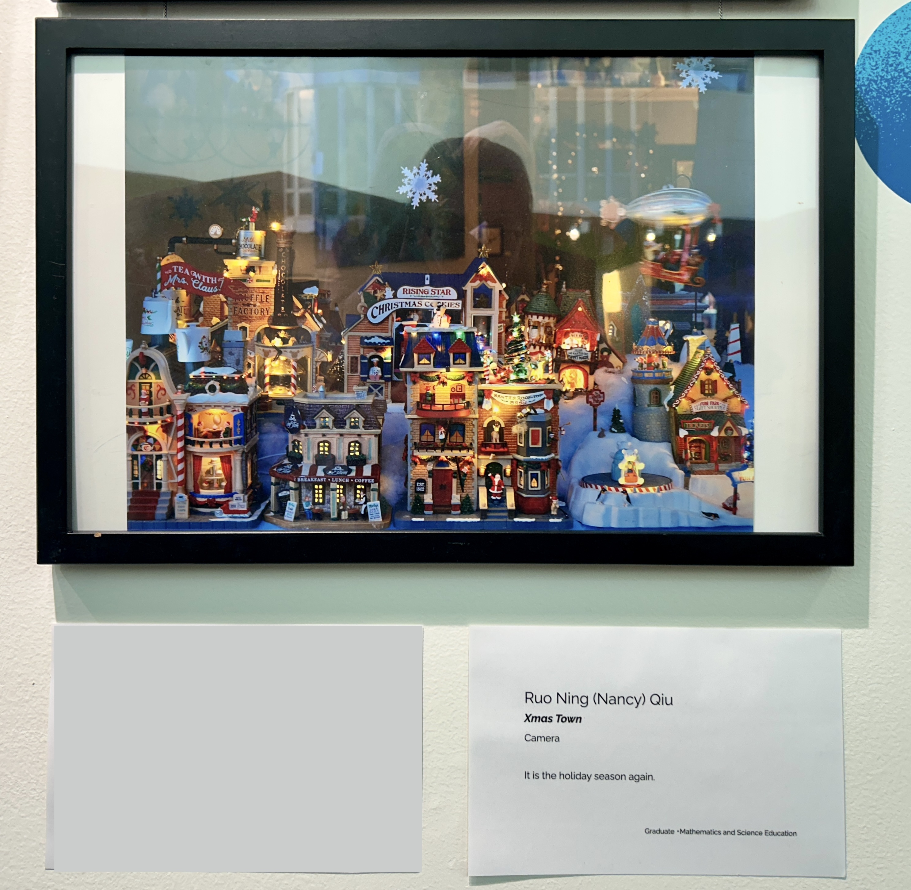
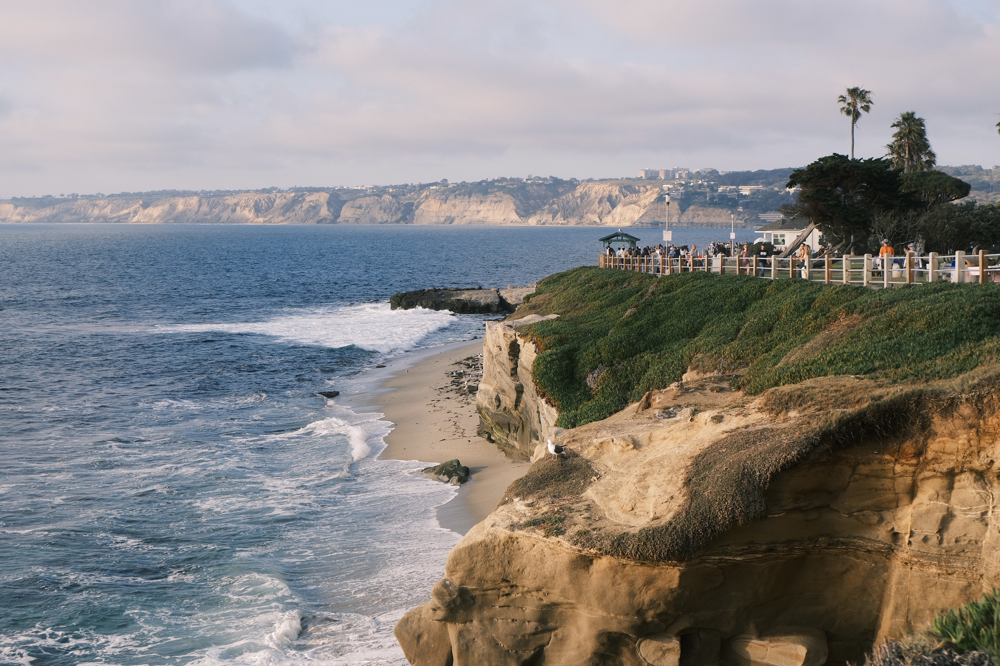
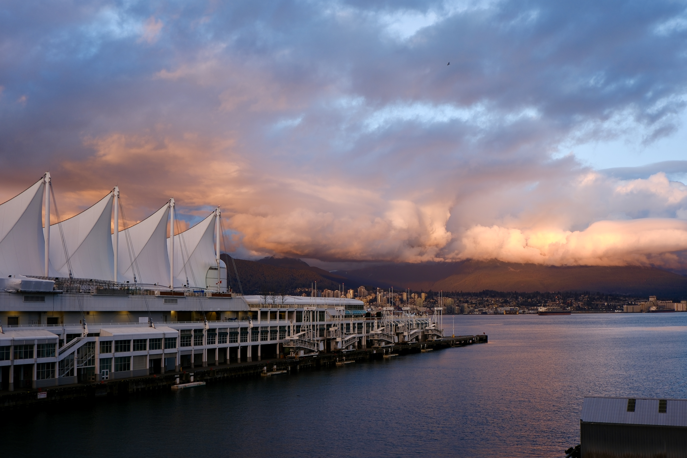

Outside of my academic work, I enjoy doing hands-on hobbies such as origami folding, journaling, and drawing. I start learning how to watercolor painting lately and taking photos of landscapes whenever I have the chance.

### :jigsaw: Origami Folding

Here are three of my favorite origami designs. I folded them myself, based on the following models:

  

    
    

      Model: I Heart Cat Designer: Michelle Fung
    

  

  

    
    

      Model: Winter Tale Designer: Valentina Minayeva
    

  

  

    
    

      Model: Anise Designer: Ekaterina Lukasheva
    

  

### :camera_flash: Photography

In Fall 2026, two of my photographs were selected for *Dream Destinations*, a student photography and digital art exhibition organized by UC San Diego's University Centers and displayed at the Price Center!

<!-- PhotoSwipe CSS -->
<link rel="stylesheet" href="https://cdn.jsdelivr.net/npm/photoswipe@5.4.4/dist/photoswipe.css" />

<!-- Featured photographs -->

  <!-- Scripps Pier -->
  <a class="featured-photo"
     href="/assets/img/personal/NancyQiu_Scripps_Pier.jpeg"
     data-pswp-width="6000"
     data-pswp-height="4000">

    

    
      click to view the original photo
    
  </a>

  <!-- Xmas Town -->
  <a class="featured-photo"
     href="/assets/img/personal/NancyQiu_Xmas_Town.jpeg"
     data-pswp-width="6000"
     data-pswp-height="4000">

    

    
      click to view the original photo
    
  </a>

  Dream Destinations · UC San Diego Price Center · Fall 2026

<!-- Other photographs -->

More moments I captured:

  

  

  

  

  

<!-- PhotoSwipe JavaScript -->

